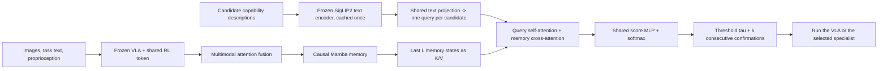

# MARS: Memory-Augmented Router for atomic Skills

[中文说明](README.zh-CN.md)

MARS decides, at every control step, **which controller should act**: a frozen generalist
vision-language-action (VLA) policy or one of several atomic-skill specialists (for example
*Pickup* and *Place*). It reads the current multimodal observation, keeps a dense causal memory
of the episode, and scores every candidate controller through a query built from that
controller's plain-language capability description. A k-of-k confirmation rule turns the scores
into reliable handoffs.

This repository contains the router, candidate-text encoding, skill switcher, shared RL Token
adapter, TD3 chunk specialists, replay, training and routed execution. Supply a frozen VLA and
environment through the feature and normalized-action interfaces. The RL modules are adapted
from RL-Token-Pi05-open's `routerlt` implementation; see the [integration guide](docs/rltoken.zh-CN.md).

## Method



1. **Modality fusion.** The RL token z_t, mean-pooled features of two cameras and of the task
   language, and the normalized proprioception q_t are projected per modality. One Transformer
   layer mixes them, and a learned attention query pools them into one token per step.
2. **Causal memory.** A selective state-space (Mamba) trunk advances its state by one step per
   router query (O(1) at deployment). The last L = 8 trunk outputs are kept as keys and values.
3. **Candidate-skill queries.** Each candidate is described in text, for example *"grasp the black
   bowl by its rim and lift it up"*. The frozen SigLIP2 text encoder embeds the descriptions once.
   A shared trainable projection turns each embedding into a query. The queries run
   self-attention among themselves and cross-attention over the memory. A shared score MLP gives
   one logit per candidate, and a softmax gives the probabilities. The queries come only from the
   candidate texts; there is no skill-ID input or learned per-controller embedding. The candidate
   list sets the output order, and permuting it permutes the outputs.
4. **Skill switching.** The top-scoring controller takes over once its probability reaches tau
   on k consecutive queries (defaults tau = 0.6, k = 2, cooldown 0). Below the threshold the
   current controller keeps control. Every handoff discards the previous controller's queued
   action chunk and queries the new controller at the same step.

With the default configuration (`configs/mars.yaml`, SmolVLA feature width 960, three
candidates), MARS has 1,382,161 trainable parameters.

## Install

```bash
pip install -e ".[test]"          # torch, numpy, pyyaml (+ pytest)
pip install -e ".[siglip2]"       # only needed to encode new candidate descriptions
pytest                            # CPU unit tests, about 15 s
python examples/train_synthetic.py
```

## Usage

### 1. Encode the candidate descriptions (once)

```bash
python -m mars.text --config configs/mars.yaml --classes vla pickup place --output siglip2_text.pt
```

The cache stores the encoder name, the candidate order and the exact descriptions.
`load_text_cache` refuses a cache that does not match the current configuration.

### 2. Train

```python
from mars import MARSConfig, build_router, save_router, train_router
from mars.text import candidate_embeddings

cfg = MARSConfig.from_yaml("configs/mars.yaml")
classes = ["vla", "pickup", "place"]                  # index 0 is the generalist
text, spec = candidate_embeddings(cfg, classes, out_dir="cache")
router = build_router(cfg.type, sum(cfg.modality_dims), len(classes), cfg, text_dim=text.shape[1])
router.set_text_embeddings(text)

# train_seqs / val_seqs: lists of (z (T, sum(modality_dims)), y (T,), q (T, q_dim)) per episode
result = train_router(router, train_seqs, val_seqs, cfg, seed=cfg.seed)
save_router("mars.pt", router, classes, extra={"text_spec": spec})
```

The loss is cross-entropy weighted by inverse label frequency. With `select_best` the epoch with
the best validation `selection_metric` (macro-F1 by default) is kept.

### 3. Deploy

```python
from mars import MARSController, pack_modalities

ctrl = MARSController.from_checkpoint("mars.pt", cfg)
ctrl.reset()                                           # at every episode start
for t in range(max_steps):
    z_t = pack_modalities(prefix_features, rl_token)[0]   # (sum(modality_dims),)
    active, switched, probs = ctrl.query(z_t, q_t)
    if switched:
        action_queue.clear()                           # the old controller's chunk is invalid
    if not action_queue:
        action_queue.extend(policies[ctrl.active_name](obs))
    env.step(action_queue.popleft())
```

### 4. Offline evaluation

`mars.metrics.selector_report` reports per-step accuracy, macro-F1 and specialist F1. It also
reports per-interval IoU, false entries, missed intervals and entry/exit lag. With
`switch_grid=[(tau, k), ...]` and the per-step probabilities, it computes the same metrics for
the *deployed* owner after the switcher is replayed.

## RL Token and specialist learning

```bash
python -m examples.train_rltoken_synthetic  # CPU smoke run of the complete module chain
python -m mars.rltoken --help

python -m mars.rltoken train-adapter --data tokens.npz \
  --config configs/rltoken.yaml --output outputs/adapter --device cuda
python -m mars.rltoken train-specialist --data pickup_windows.npz \
  --config configs/rltoken.yaml --output outputs/pickup.pt --updates 5000 --device cuda
```

`mars.rltoken` provides `RLTAdapter`, `SpecialistLearner`, `ReplayBuffer`, `EpisodeLog`,
`build_windows`, checkpoint loaders, and `RoutedRLTPolicy`. Cached adapter data contains
`tokens (N, slots, d_vla)`, `mask (N, slots)`, `token_groups`, and `group_sizes` as NPZ arrays.
Specialist windows contain `z`, `q`, `ref`, `act`, `rew`, `valid`, `done`, `next_z`, `next_q`,
and `next_ref`; use `build-windows` to construct them from an episode. Resume training with
`--resume outputs/pickup.pt` and its paired `.replay.npz` file; `--updates` counts additional updates.

During deployment, `RoutedRLTPolicy` shares one frozen adapter across the router and all
specialists, calls a user-supplied VLA reference callback, and clears queued actions immediately
when MARS switches controllers. Actions and proprioception use the same normalization as training;
unnormalize actions in the environment adapter. See the [data and deployment guide](docs/rltoken.zh-CN.md).
Existing `routerlt` adapter and chunk specialist checkpoints are supported (supply the matching
config for older specialist checkpoints); the original pi05 causal-decoder and DSRL checkpoints
use different formats. VLA/robot drivers and simulator environments are supplied separately.

## Tube-transfer workcell

`mars.tubes` is a robosuite 1.4 / MuJoCo Panda workcell (`tubes_v2`) in which three tubes are moved
one by one from a fixed source rack into a randomised target rack, with a privileged scripted
controller and ground-truth skill labels (`pickup`, `insert`). It needs `pip install -e .[tubes]` and
`NUMBA_DISABLE_JIT=1`; see [docs/tubes.zh-CN.md](docs/tubes.zh-CN.md).

## Inputs

| Input | Shape | Source |
|---|---|---|
| `z_t` | `sum(modality_dims)` | `pack_modalities(features, z)`: [RL token, mean(camera 1), mean(camera 2), mean(language)] |
| `q_t` | `q_dim` | normalized proprioception |
| `y_t` (training only) | scalar | controller label, 0 = generalist |

`features` is the frozen VLA prefix of the current observation. It must provide `.hidden`
`(B, N, d)`, `.slices` (token ranges named `image`, `image2` and `lang`) and `.group_masks`
(token validity per range). No phase, progress, reward or simulator state enters the router.

## Router kinds

| Kind | Description |
|---|---|
| `mars` | MARS: modality fusion + Mamba memory + candidate-skill text queries |
| `mars_gru` | the same, with a GRU memory trunk |
| `mars` + `skill_query: false` | direct linear classifier instead of candidate queries (ablation) |
| `mamba_head`, `mamba_query`, `gru_query` | recurrent trunk on the packed vector, without modality fusion |
| `gru` | GRU recurrent router (comparison) |
| `windowed_query`, `windowed_tf`, `windowed_xattn` | windowed query router: a causal window of L samples taken `window_stride` steps apart, instead of a dense memory (comparison) |

All kinds share the same interface: `forward_seq(z, q)` for training (causal over time), and
`init_state()` + `step(z_t, state, q_t)` for streaming. `step` matches `forward_seq` up to floating-point error.
Every kind that uses candidate queries builds them from the candidate texts. `load_router`
refuses checkpoints that use learned skill-ID queries.

## Layout

```
mars/
  router.py      MARSRouter, RecurrentRouter, pack_modalities
  layers.py      MambaBlock, QueryBlock, SelfBlock, window helpers
  baselines.py   GRURouter, WindowedQueryRouter
  text.py        SigLIP2 candidate-text encoding and validated cache
  switch.py      SkillSwitcher (tau, k-of-k, cooldown), replay_switch
  controller.py  MARSController: streaming router + switcher
  train.py       train_router, predict, class_weights
  metrics.py     selector_report and interval metrics
  registry.py    build_router, save_router, load_router
  config.py      MARSConfig
  rltoken/       Shared adapter, TD3 specialists, replay windows, routed execution and CLI
  tubes/         Tube-transfer robosuite workcell, scripted controller and skill labels
configs/mars.yaml
configs/rltoken.yaml
examples/train_synthetic.py
tests/
```

## License

Apache License 2.0. See [LICENSE](LICENSE).
