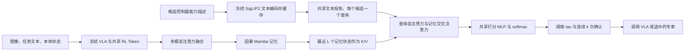

# MARS：面向原子技能的记忆增强路由器

[English](README.md)

MARS 在每个控制步决定**由哪个控制器执行**：冻结的通用视觉-语言-动作（VLA）策略，或若干原子技能专家之一（例如 *Pickup*、*Place*）。它读取当前的多模态观测，维护整个 episode 的稠密因果记忆，并用每个候选控制器的自然语言能力描述构造查询，为候选逐一打分。打分再经过连续确认规则，得到稳定的交接。

本仓库包含路由器、候选文本编码、技能切换器、共享 RL Token 编码器与训练、TD3 技能专家、经验回放和路由执行。冻结 VLA 与环境通过特征和动作接口接入。完整 RL 使用说明见 [RL Token 集成指南](docs/rltoken.zh-CN.md)。

## 方法



1. **模态融合**：RL Token z_t、两个相机和任务语言的池化特征、归一化本体状态 q_t 分别投影。一层 Transformer 混合各模态，再由一个可学习的注意力查询池化为每步一个 token。
2. **因果记忆**：选择性状态空间（Mamba）主干每次路由查询推进一步，部署时每步 O(1)。保留最近 L = 8 个主干输出作为键和值。
3. **候选技能查询**：每个候选用文本描述，例如 *"grasp the black bowl by its rim and lift it up"*。冻结的 SigLIP2 文本编码器只编码一次。共享的可训练投影把每个描述变为查询，查询之间做自注意力，并对记忆做交叉注意力。共享打分 MLP 为每个候选输出一个 logit，softmax 给出概率。查询只来自候选文本，不输入技能 ID，也没有逐控制器的可学习嵌入。候选列表决定输出顺序，打乱候选顺序，输出也按同样方式重排。
4. **技能切换**：分数最高的控制器在连续 k 次查询中概率都达到 tau，才接管控制（默认 tau = 0.6、k = 2、冷却期 0）。低于阈值时保持当前控制器。每次交接都会丢弃旧控制器已排队的动作块，并在同一步立即查询新控制器。

默认配置（`configs/mars.yaml`，SmolVLA 特征宽度 960，三个候选）下，MARS 有 1,382,161 个可训练参数。

## 安装

```bash
pip install -e ".[test]"          # torch、numpy、pyyaml（以及 pytest）
pip install -e ".[siglip2]"       # 仅在需要编码新的候选描述时安装
pytest                            # CPU 单测，约 15 秒
python examples/train_synthetic.py
```

## 使用

### 1. 编码候选描述（只需一次）

```bash
python -m mars.text --config configs/mars.yaml --classes vla pickup place --output siglip2_text.pt
```

缓存中记录编码器名称、候选顺序和完整描述。若缓存与当前配置不一致，`load_text_cache` 会拒绝加载。

### 2. 训练

```python
from mars import MARSConfig, build_router, save_router, train_router
from mars.text import candidate_embeddings

cfg = MARSConfig.from_yaml("configs/mars.yaml")
classes = ["vla", "pickup", "place"]                  # 0 号为通用策略
text, spec = candidate_embeddings(cfg, classes, out_dir="cache")
router = build_router(cfg.type, sum(cfg.modality_dims), len(classes), cfg, text_dim=text.shape[1])
router.set_text_embeddings(text)

# train_seqs / val_seqs：每个 episode 一个 (z (T, sum(modality_dims)), y (T,), q (T, q_dim))
result = train_router(router, train_seqs, val_seqs, cfg, seed=cfg.seed)
save_router("mars.pt", router, classes, extra={"text_spec": spec})
```

损失为按类别频率倒数加权的交叉熵。开启 `select_best` 时，保留验证集 `selection_metric`（默认 macro-F1）最好的 epoch。

### 3. 部署

```python
from mars import MARSController, pack_modalities

ctrl = MARSController.from_checkpoint("mars.pt", cfg)
ctrl.reset()                                           # 每个 episode 开始时
for t in range(max_steps):
    z_t = pack_modalities(prefix_features, rl_token)[0]   # (sum(modality_dims),)
    active, switched, probs = ctrl.query(z_t, q_t)
    if switched:
        action_queue.clear()                           # 旧控制器的动作块已失效
    if not action_queue:
        action_queue.extend(policies[ctrl.active_name](obs))
    env.step(action_queue.popleft())
```

### 4. 离线评估

`mars.metrics.selector_report` 报告逐步准确率、macro-F1、专家 F1，以及区间 IoU、误进入、漏检区间和进入/退出延迟。传入 `switch_grid=[(tau, k), ...]` 和逐步概率时，会回放切换器，对**实际部署的控制者**计算同样的指标。

## RL Token 与专家训练

```bash
python -m examples.train_rltoken_synthetic  # CPU 完整调用链冒烟测试
python -m mars.rltoken --help              # adapter 训练、窗口构造、专家训练/恢复
```

配置为 `configs/rltoken.yaml`；Python API 位于 `mars.rltoken`。详见 [训练数据、在线更新与部署](docs/rltoken.zh-CN.md)。

## 试管搬运仿真

`mars.tubes` 是基于 robosuite 1.4 / MuJoCo 的 Panda 试管搬运工作台（`tubes_v2`）：三支试管从固定源架依次插入位姿随机化的目标架，
自带特权脚本控制器和真值技能标签（`pickup`、`insert`）。需要 `pip install -e .[tubes]` 并设置 `NUMBA_DISABLE_JIT=1`，
详见 [docs/tubes.zh-CN.md](docs/tubes.zh-CN.md)。

## 输入

| 输入 | 形状 | 来源 |
|---|---|---|
| `z_t` | `sum(modality_dims)` | `pack_modalities(features, z)`：[RL Token、相机 1 均值、相机 2 均值、语言均值] |
| `q_t` | `q_dim` | 归一化本体状态 |
| `y_t`（仅训练） | 标量 | 控制器标签，0 为通用策略 |

`features` 是当前观测在冻结 VLA 中的前缀特征，需要提供 `.hidden` `(B, N, d)`、`.slices`（名为 `image`、`image2`、`lang` 的 token 区间）和 `.group_masks`（各区间 token 的有效性）。阶段、进度、奖励和仿真器状态都不进入路由器。

## 路由器类型

| 类型 | 说明 |
|---|---|
| `mars` | MARS：模态融合 + Mamba 记忆 + 候选技能文本查询 |
| `mars_gru` | 同上，记忆主干换为 GRU |
| `mars` + `skill_query: false` | 用直接线性分类头代替候选查询（消融） |
| `mamba_head`、`mamba_query`、`gru_query` | 在打包向量上直接使用循环主干，不做模态融合 |
| `gru` | GRU 循环路由器（对照） |
| `windowed_query`、`windowed_tf`、`windowed_xattn` | 窗口查询路由器：用间隔 `window_stride` 步采样的 L 个因果窗口样本代替稠密记忆（对照） |

所有类型接口一致：训练用 `forward_seq(z, q)`（时间上因果），流式部署用 `init_state()` 加 `step(z_t, state, q_t)`，`step` 与 `forward_seq` 的输出在浮点误差范围内一致。所有使用候选查询的类型都由候选文本构造查询；`load_router` 会拒绝使用可学习技能 ID 查询的检查点。

## 目录

```
mars/
  router.py      MARSRouter、RecurrentRouter、pack_modalities
  layers.py      MambaBlock、QueryBlock、SelfBlock、窗口工具
  baselines.py   GRURouter、WindowedQueryRouter
  text.py        SigLIP2 候选文本编码与校验缓存
  switch.py      SkillSwitcher（tau、连续 k 次、冷却期）、replay_switch
  controller.py  MARSController：流式路由 + 切换
  train.py       train_router、predict、class_weights
  metrics.py     selector_report 与区间指标
  registry.py    build_router、save_router、load_router
  config.py      MARSConfig
  rltoken/       共享表示、参考动作专家、TD3、回放、路由执行与 CLI
  tubes/         试管搬运 robosuite 工作台、脚本控制器与技能标签
configs/mars.yaml
configs/rltoken.yaml
examples/train_synthetic.py
tests/
```

## 许可证

Apache License 2.0，见 [LICENSE](LICENSE)。
